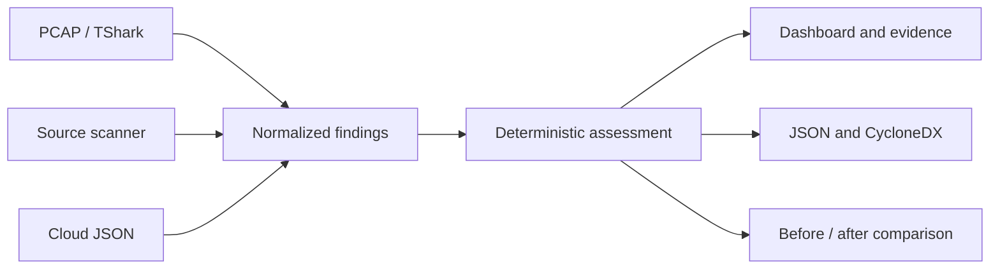

# QuantumTrace — 24-hour build & delegation plan

> Five people · Hackathon demo first · Research reviewed 10 October 2026
>
> **Goal:** turn source code, network captures, and cloud configuration into an evidence-backed cryptographic inventory and an actionable migration plan.

Open [the interactive task board](./QUANTUMTRACE_TASK_BOARD.html) in a browser to assign names and track completion. GitHub displays HTML source; download the file and open it locally to use the board, or serve it with an existing static host. The board needs no build step or external dependencies.

## 1. Decision and scope

Reuse proven discovery components. Build the integration, evidence model, careful classification, prioritization, and before/after experience yourselves.

The original contribution is the ability to answer: **What cryptography do we have, what evidence proves it, who owns it, and what should change first?** Existing commercial and open-source products already generate cryptographic inventories; do not claim invention of CBOM or unique discovery coverage.

The brief allocates 40% to accuracy/risk scoring, 25% to input coverage, 20% to standardization/traceability, and 15% to usability/demo. Source: [challenge PDF](./Inspiring%20Solutions%20-%20JunctionX%20Lisbon%202026.pdf).

### Required MVP

- Ingest the supplied PCAP, Python/Java/Go sources, and three AWS-style JSON exports.
- Normalize findings with exact evidence and clearly identified unknowns.
- Separate quantum exposure from existing cryptographic weaknesses and operational posture.
- Display a prioritized inventory, evidence details, owner filters, and recommendations.
- Export project JSON and schema-validated CycloneDX 1.6.
- Compare original and clearly labelled modified demo fixtures.
- Run locally with one documented start command; no live infrastructure or AI service required.

### Stretch only after the required flow works

SSH classification, richer cross-source correlation with verified identity mapping, live sandbox probing, and optional LLM explanations of already verified findings.

### Out of scope for this event

Automatic production remediation, building cryptographic primitives, general binary analysis, exhaustive whole-program analysis, multi-cloud connectors, enterprise authentication, and a universal compliance score.

## 2. What is in the starter kit

Inspected commit: `39e8f18dcfb5edc66eda0f47bb44884aa7db5c9c` in [JunctionX-QuantumTrace](https://github.com/joaoalves3901/JunctionX-QuantumTrace/tree/39e8f18dcfb5edc66eda0f47bb44884aa7db5c9c).

| Input | Supplied material | Implementation consequence |
| --- | --- | --- |
| Source | 24 files: eight Python, eight Java, eight Go | Bounded API coverage across all three languages is feasible. |
| Cloud | 10 KMS keys, six load balancers, five certificates | Preserve owner tags and explicitly linked certificate/listener relationships. |
| Network | 2,000 packets; README describes ~135 sessions including TLS applications, SSH, HTTP, and DNS | Start with TLS; account for unsupported protocols. |

Patterns include RSA-1024/SHA-1 signatures, Ed25519, AES-ECB, AES-256-GCM, MD5 password hashing, PBKDF2, and HMAC. Cloud exports are synthetic snapshots. Their timestamps are not live scan timestamps. The PCAP was checked for readability and packet count, not exhaustively classified during research. Candidate scanners have not yet been benchmarked on the supplied data.

## 3. Reuse decisions

| Component | Choice | Time limit / fallback |
| --- | --- | --- |
| PCAP parsing | TShark + small Python adapter | Verify required fields and reassembly against actual captures; pin version. |
| Source scanning | Evaluate CSNP CryptoScan | 45-minute evaluation; fallback to bounded API-pattern rules with documented limitations. |
| Alternative source scanner | CBOMkit Sonar Cryptography | Use only if someone is already productive with SonarQube; avoid a long setup. |
| Cloud ingestion | Small purpose-built JSON adapter | Only supplied schemas and explicit policy mappings. |
| Assessment | Versioned deterministic Python rules | No LLM in the classification path. |
| UI | React for an experienced frontend owner; otherwise Streamlit | Select in the first hour and do not switch late. |
| Report | CycloneDX 1.6 plus project JSON | Validate the exported CBOM against a pinned schema. |

IBM Quantum Safe Explorer and SandboxAQ AQtive Guard are product benchmarks. CryptoScan documents pattern-based scanning; validate its precision and output rather than trusting its marketing or assuming its CBOM output fully meets the brief. quantum-sniffer is an alpha alternative with GPL-3.0 licensing. Record selected versions and retain applicable license notices for reused components.

## 4. Shared architecture and contract



Person 4 owns the schema; every adapter owner reviews it in hour 1. Suggested files and endpoints are proposed implementation boundaries, not existing code.

### Finding v1 — illustrative contract

The alternatives separated by `|` below describe enum choices, not literal output values. Use `null` for unavailable parameters. Keep the detected fact distinct from its assessed risk.

```json
{
  "schema_version": "1.0",
  "id": "stable-finding-id",
  "asset_id": "stable-resource-or-occurrence-id",
  "source_type": "pcap | source | cloud",
  "algorithm": "canonical algorithm name",
  "parameters": {
    "key_bits": null,
    "mode": null,
    "named_group": null
  },
  "usage": "key_establishment | signature | encryption | hash | mac | kdf | unknown",
  "evidence_kind": "declared | configured | offered | observed",
  "evidence": [
    {
      "file": "input path",
      "locator": "line range / JSON pointer / frame and stream",
      "detail": "what supports the finding"
    }
  ],
  "confidence": "high | medium | low",
  "quantum_status": "vulnerable | resistant_primitive | hybrid | unknown | not_applicable",
  "challenge_tier": "critical | medium | resilient | unknown",
  "classical_issues": [],
  "owner": null,
  "observed_at": null,
  "rule_id": "versioned-rule-id",
  "rationale": "explanation",
  "recommendation": "specific next action",
  "references": [
    "authoritative source URL"
  ]
}
```

### ScanResult v1

Include `schema_version`, `scan_id`, `started_at`, `evaluated_at`, `ruleset_version`, `tool_versions`, `input_hashes`, `findings`, `coverage`, and `errors`.

Coverage must include assessed, unknown, unsupported, and failed counts with units for each input type. Do not combine files, packets, sessions, and cloud resources into one unexplained percentage. Successful findings survive another adapter's failure.

Suggested API: `POST /api/scans`, `GET /api/scans/{id}`, and `GET /api/scans/{id}/export?format=json|cyclonedx`. Agree the upload manifest and response examples in hour 1. Streamlit may call the same core functions directly without HTTP.

Stable asset and finding IDs must permit before/after matching. Deduplicate repeated sightings of the same asset/usage without merging unrelated assets merely because they use the same algorithm. Keep all corroborating evidence.

### Assessment rules that must not be lost

1. TLS 1.3 and AES-256 alone do not prove quantum-resilient key exchange or authentication.
2. Client offers are not negotiated selections. Configuration is not observed runtime use.
3. Passive TLS 1.3 normally hides certificate and CertificateVerify data after ServerHello; preserve unknowns.
4. Ed25519 is classical elliptic-curve cryptography, not PQC.
5. Distinguish obsolete draft Kyber groups from standardized ML-KEM groups.
6. ML-KEM supports key establishment; ML-DSA and SLH-DSA support signatures. Replacement advice depends on usage and platform support.
7. AES-128's challenge tier is a policy simplification, not evidence of a practical quantum break. Explain NIST's more nuanced guidance.
8. Keep MD5/SHA-1 issues, unsafe modes, key rotation, and expiry separate from quantum exposure. Assess hashes in their actual usage context.
9. A resilient primitive does not certify the whole application. HMAC/PBKDF2 strength depends on parameters and key/password handling.
10. Do not infer facts from sample filenames, comments, asset names, or absent observations.

### Scoring policy

Show quantum exposure, existing weaknesses, and coverage separately. Define a reproducible project-specific score over deduplicated assessed assets, publish its weights and denominator, and label it as a heuristic rather than a NIST metric or probability. Show unknown/unsupported counts beside it. Prioritize known exposure and user-supplied business context without quietly treating missing context as low risk. Do not average packet-level findings into an enterprise score.

## 5. Assignments

Replace the owner blanks with teammate names. Each owner implements and checks their component; Person 4 coordinates integration rather than fixing every component alone. Every owner shares a small fixture and expected output early.

### Person 01 — Network discovery

**Owner:** ____________________

**Best fit:** Networking · Python

**Boundary:** `adapters/network.py`

**Deliverable:** PCAP → normalized TLS observations

**Dependencies:** Use the shared Finding schema from Person 4. Send one real observation to Person 5 by hour 3.

- [ ] **N1 · Inspect the supplied capture (0–2h)** — Inspect protocol mix with TShark. Identify TLS on non-443 ports and STARTTLS where supported. Record observed coverage and unsupported traffic; do not assume all 135 sessions are TLS.
- [ ] **N2 · Build the PCAP adapter (2–6h)** — Parse TShark output into shared findings. Retain input file, frame numbers, stream/endpoint IDs, and capture time. Use reassembly; pin and record the TShark version.
- [ ] **N3 · Separate offers from selections (6–10h)** — Keep ClientHello offers separate from ServerHello selections. Identify classical, standardized PQ, obsolete draft, and unknown groups from a pinned registry mapping. Handle incomplete captures and HelloRetryRequest conservatively.
- [ ] **N4 · Report evidence limits (10–14h)** — TLS 1.3 encrypted certificate/signature details remain unknown without supporting evidence. Keep key exchange, authentication, and symmetric encryption separate. Do not infer PQ safety from AES-256 or TLS 1.3 alone.
- [ ] **N5 · Deliver fixtures and coverage (14–18h)** — Add positive, negative, incomplete, and hybrid cases; report supported/unsupported session counts. Provide one evidence drill-down for the demo. SSH analysis is stretch scope only.

**Acceptance criteria**

- Selected and offered algorithms never become the same observation.
- Every observed finding points to a capture and frame/session.
- Unknown, unsupported, and parse failures remain visible.
- Hybrid key exchange does not imply PQ authentication.

**Handoff:** Provide one classical TLS finding, one hybrid fixture, and one incomplete-handshake finding using the shared schema.

### Person 02 — Source discovery

**Owner:** ____________________

**Best fit:** Python · Static analysis

**Boundary:** `adapters/source.py`

**Deliverable:** Python / Java / Go → findings with file and line evidence

**Dependencies:** Person 4 defines normalization and risk rules. Person 5 consumes example findings before the scanner is complete.

- [ ] **S1 · Evaluate reuse in 45 minutes (0–2h)** — Try CryptoScan against the 24 supplied files. Check file/line evidence, RSA sizes, AES modes, and output shape. Pin the selected version and keep license notices. If integration is awkward, use bounded API-pattern rules; do not spend hours setting up SonarQube.
- [ ] **S2 · Normalize source observations (2–6h)** — Implement an adapter over scanner JSON or bounded rules. Keep imported/declared crypto distinct from runtime use. Preserve file, line, API call, and scanner/rule identity.
- [ ] **S3 · Cover essential patterns (6–10h)** — Cover RSA/SHA-1 signatures, Ed25519, AES-ECB, AES-GCM, MD5, SHA-1, PBKDF2, and HMAC in the supplied languages. Resolve simple constants for lengths where supported; mark unresolved values unknown.
- [ ] **S4 · Control false positives (10–14h)** — Check comments, unused imports, aliases, strings, and unknown parameters. Distinguish byte lengths from bit lengths. HMAC is not a public-key signature; Ed25519 is not PQ. Do not claim whole-program data-flow analysis.
- [ ] **S5 · Deliver a labelled evaluation (14–18h)** — Make a small expected-results inventory and holdout variations. Report precision/recall where labels exist and list known gaps. Do not hard-code filenames as detection rules.

**Acceptance criteria**

- All three languages have at least one correctly evidenced finding.
- RSA-1024 and Ed25519 are identified as quantum-vulnerable asymmetric primitives.
- AES modes and supported key sizes survive normalization.
- Comments/imports alone are not labelled as executed cryptography.

**Handoff:** Provide representative risky, resilient-primitive, and unknown-parameter observations plus the supported-pattern list.

### Person 03 — Cloud posture

**Owner:** Santiago

**Best fit:** JSON / APIs · Cloud security

**Boundary:** `adapters/cloud.py`

**Deliverable:** KMS + load balancers + certificates → linked inventory

**Dependencies:** Use Person 4’s schema. Join only explicit identifiers; do not manufacture code-to-cloud or network-to-cloud links.

- [x] **C1 · Parse all three supplied exports (0–3h)** — Load the 10 KMS keys, six load balancers, and five certificates. Preserve ARNs, usage, state, owner tags, evidence JSON pointer, and export timestamp. Treat them as synthetic snapshots, not live AWS state.
- [x] **C2 · Resolve real relationships (3–6h)** — Join listener CertificateArn to certificate records. Preserve KMS team tags. Keep missing references as unresolved. Similar names are not evidence of a dependency.
- [x] **C3 · Map algorithm and policy meaning (6–10h)** — Map KeySpec and KeyUsage separately. Build an explicit, sourced lookup for the supplied ALB and NLB policies using the appropriate AWS documentation. Unknown policies remain unknown. Do not infer policy contents from the year or name alone.
- [x] **C4 · Separate posture from quantum risk (10–14h)** — Report expiry, weak signatures, HTTP redirect versus plaintext forwarding, rotation, and pending deletion separately from quantum exposure. Parameterize evaluation time and display snapshot freshness. Do not claim configured algorithms were observed on the wire.
- [x] **C5 · Prepare the migration demonstration (14–18h)** — For partner-api-alb, explain the existing non-PQ TLS 1.3 policy and a compatible current AWS hybrid-PQ alternative. Rescan a clearly labelled modified fixture. Show PQ-capable configuration while observed negotiation remains unverified.

**Acceptance criteria**

- All 21 top-level cloud resources are inventoried; listeners are preserved as child resources.
- All five supplied certificate references resolve.
- Ownership and evidence pointers appear in findings.
- Changing a policy updates configuration assessment without fabricating network evidence.

**Handoff:** Deliver linked listener/certificate examples, owner-tagged KMS examples, and original/modified demo fixtures.

**Cloud integration:** See [cloud handoff](docs/scanners.md), [raw API input](docs/scanners.md), and [generated migration example](examples/migration.json). The registered adapter uses Person 4's shared contract; raw service/API tests cover inventory, posture, provenance and JSON/CycloneDX exports. Network/source and the final frontend remain separate team handoffs.

**Certificate renewal demo:** A separate [synthetic reimport comparison](docs/scanners.md)
removes expiry and SHA-1 posture issues without changing certificate identity or
claiming PQ authentication. Run `python3 -B -m adapters.cloud_demo --certificate-renewal`.
Import [cloud progress](docs/cloud-progress.json) into the HTML board to show C1–C5 completion;
export any existing team progress first because import replaces local state.

### Person 04 — Core & integration

**Owner:** ____________________

**Best fit:** Backend · Security reasoning

**Boundary:** `core/ + api/ + export/`

**Deliverable:** Shared schema, rules, scoring, API, and valid CBOM

**Dependencies:** Publish schema and example JSON in the first hour. All three adapter owners must agree before parallel implementation.

- [ ] **E1 · Freeze the shared contract (0–1h)** — Define Finding v1 and ScanResult v1, including null/unknown semantics, evidence kinds, stable IDs, asset identity, errors, and coverage. Commit example JSON for all roles and a minimal API contract.
- [ ] **E2 · Deliver the integration skeleton (1–6h)** — Implement adapter dispatch and aggregation. Provide POST /api/scans, GET /api/scans/{id}, and GET /api/scans/{id}/export?format=json|cyclonedx. A synchronous first version is acceptable. Streamlit may call the same core functions directly.
- [ ] **E3 · Implement deterministic assessment (6–10h)** — Version algorithm rules and cite rationale. Separate challenge tiers, quantum status, classical weaknesses, confidence, and remediation. Recommend KEMs for key establishment and signature schemes for signing; never blanket-replace RSA with ML-KEM.
- [ ] **E4 · Build score and CBOM export (10–14h)** — Use one documented scoring policy over deduplicated assessed assets and show coverage separately. Unknown assets do not become safe. Export CycloneDX 1.6 cryptographic assets, evidence, relationships, and namespaced project properties; validate against a pinned schema.
- [ ] **E5 · Own the release gate (14–21h)** — Run integration and accuracy fixtures, verify exports, and provide one documented local start command with pinned dependencies. Handle parser failure without losing successful findings. Coordinate fixes with component owners.

**Acceptance criteria**

- All adapters emit the same validated contract.
- Scores are reproducible and unknown coverage is visible.
- JSON and CycloneDX exports work and the latter validates.
- A clean environment can run the supplied fixtures with documented commands.

**Handoff:** Publish schema examples by hour 1, working scan API by hour 6, and a validated report plus reproducible run command by hour 18.

### Person 05 — Experience & demo

**Owner:** ____________________

**Best fit:** Frontend · Product / storytelling

**Boundary:** `web/ + docs/demo.md`

**Deliverable:** Dashboard, evidence drill-down, comparison, and pitch

**Dependencies:** Start with Person 4’s example JSON. Do not wait for finished scanners. Ask each adapter owner for one demo-worthy finding.

- [ ] **U1 · Build against example data (0–3h)** — Create upload, scan summary, prioritized findings, and evidence detail screens. Use React if comfortable, otherwise Streamlit. Show synthetic fixture labels and assessment coverage.
- [ ] **U2 · Connect the first complete flow (3–6h)** — Upload → scan → findings → evidence → export must work with at least one real input. Keep useful empty, loading, error, and partial-success states.
- [ ] **U3 · Make prioritization understandable (6–12h)** — Filter by owner, input source, evidence kind, and risk. Show why a finding matters and how to address it. Keep quantum exposure, existing weaknesses, and unknowns visually distinct.
- [ ] **U4 · Add before/after comparison (12–18h)** — Compare stable asset IDs across original and modified cloud fixtures. Show exactly which configuration findings changed and which facts remain unknown. Never present a simulated fixture edit as a live cloud remediation.
- [ ] **U5 · Rehearse and package the story (18–24h)** — Prepare a three-minute pitch, screenshots, and a backup video. Rehearse on a clean local start. Explain reused components and the team’s original contribution. Freeze features at hour 21.

**Acceptance criteria**

- A judge can find the highest-priority issue and its evidence in under a minute.
- Evidence kind and unknown coverage are visible.
- The demo completes without an external AI service or live cloud account.
- Export and before/after paths are rehearsed.

**Handoff:** A functioning UI by hour 6, integrated demo by hour 18, and backup recording by hour 23.

## 6. Timeline and integration gates

| Elapsed time | Gate | Required result |
| --- | --- | --- |
| 0–1h | Contract & scope | Agree the schema, fixtures, tool choices, and demo story. Assign all five owners. |
| 1–6h | First integrated flow | Run one real input through ingestion, rules, UI, and export. Integrate early. |
| 6–12h | Three inputs connected | PCAP, source, and cloud adapters work. Resolve classification disagreements. |
| 12–18h | Evidence & migration | Complete traceability, prioritization, comparison, and validated CBOM. |
| 18–21h | Verification & packaging | Run labelled cases; fix failures; verify a clean local launch. |
| 21–24h | Feature freeze & rehearsal | Rehearse the pitch, capture backup video, and prepare submission. |

All times are elapsed from kickoff. Choose working rotations and breaks within the window; the plan does not assume every teammate works continuously for 24 hours. Meet briefly at hours 1, 3, 6, 12, 18, and 21. Report working outputs, blockers, and interface changes.

### If behind schedule

- No working end-to-end flow at hour 6: stop feature expansion and integrate a single real input immediately.
- Weak source coverage at hour 10: retain verified API patterns and publish limitations; do not add unsupported claims.
- Missing coverage at hour 12: finish cloud and TLS paths, retain a bounded source scan, and cut SSH/live probing.
- No schema-valid CBOM by hour 16: simplify the model and validate minimal correct assets before adding relationships.
- At hour 21: freeze features. Fix only demo failures and material classification errors.

## 7. Accuracy and release checklist

- [ ] RSA signing and RSA encryption produce usage-appropriate recommendations.
- [ ] Ed25519 is detected as Shor-vulnerable.
- [ ] AES-GCM and AES-ECB are distinguished; key lengths are correctly converted from bytes where necessary.
- [ ] MD5/SHA-1 findings retain usage context; HMAC is not mistaken for a public-key signature.
- [ ] Comments, unused imports, unknown parameters, and unsupported code do not create claims of runtime use.
- [ ] TLS offered/selected groups, incomplete handshakes, hybrid groups, and unknown IDs are handled.
- [ ] TLS 1.3 hidden authentication details are explicitly unknown without other evidence.
- [ ] Cloud policy capabilities come from sourced lookups appropriate to ALB/NLB.
- [ ] Certificate references, owner tags, and snapshot timestamps survive ingestion.
- [ ] HTTP redirect and HTTP forwarding are not conflated.
- [ ] Algorithm exposure and operational issues are reported separately.
- [ ] Repeated observations do not inflate asset scores; unknowns do not improve scores.
- [ ] A parser failure yields a partial report with a visible error.
- [ ] CycloneDX export passes schema validation and preserves traceability.
- [ ] Before/after comparison preserves asset identity and labels synthetic modifications.
- [ ] A clean local launch, exports, and the full three-minute demo have been rehearsed.

Build a small labelled corpus and holdout variations. Report measured results on that corpus only, including the sample size and known gaps. Do not claim production-wide precision from the starter files.

## 8. Three-minute demonstration

| Time | What to show | Message |
| --- | --- | --- |
| 0:00–0:25 | Upload the supplied synthetic inputs | Organizations need to know where cryptography is used and what migration requires. |
| 0:25–1:00 | Prioritized inventory and coverage | We combine three sources and distinguish evidence from uncertainty. |
| 1:00–1:35 | One finding with exact code/packet/JSON evidence | Every conclusion is explainable and traceable. |
| 1:35–2:15 | `partner-api-alb` policy and modified fixture comparison | TLS 1.3 alone is not PQ. A PQ-capable configuration still needs runtime verification. |
| 2:15–2:40 | Owner-specific next actions and validated CBOM export | Findings become a migration work list and a standard artifact. |
| 2:40–3:00 | Architecture and honest limitations | Explain reused tools, original integration, measured coverage, and next steps. |

The supplied `partner-api-alb` uses `ELBSecurityPolicy-TLS13-1-2-2021-06`. AWS currently documents hybrid-PQ policies such as `ELBSecurityPolicy-TLS13-1-2-Res-PQ-2025-09`; check compatibility before recommending one. The demonstration edits a fixture, not AWS. A successful rescan may establish PQ-capable configuration; it cannot establish observed PQ negotiation. Treat a second capture as separate evidence only when it actually exists.

## 9. Repository and collaboration workflow

- Keep this plan and the HTML board together at the repository root.
- Agree ownership of `adapters/network.py`, `adapters/source.py`, `adapters/cloud.py`, `core/`, `api/`, `export/`, and `web/` to reduce conflicts.
- Use short branches by workstream, small changes, and early integration. Schema changes require notifying all owners.
- Put shared fixtures and expected outputs under `tests/fixtures/`; clearly separate organizer inputs from modified demo fixtures.
- Track implementation commands and dependency versions in the project README as they become real.
- Do not commit private keys or extracted secret material into reports. Keep evidence to metadata and relevant non-secret context.

### How to use the HTML task board

Open `QUANTUMTRACE_TASK_BOARD.html`, enter teammate names, and check completed tasks. Search and filter by workstream or status. Owner names and progress are stored only in the current browser when browser storage is available. There is no backend or automatic teammate synchronization. Export a progress JSON file for a snapshot; teammates can import it. Import replaces current local board progress after explicit confirmation. Commit a chosen exported snapshot if the team wants a repository handoff. Printing expands task details. Markdown checkboxes and the HTML board are separate copies; edits do not synchronize.

## 10. Research references

Reviewed on 10 October 2026. Tool capabilities below are documented claims, not a completed benchmark. Pin versions used in the implementation and record mapping dates.

- [Starter repository, inspected commit](https://github.com/joaoalves3901/JunctionX-QuantumTrace/tree/39e8f18dcfb5edc66eda0f47bb44884aa7db5c9c)
- [IBM Quantum Safe Explorer](https://www.ibm.com/docs/en/quantum-safe/quantum-safe-explorer/2.x?topic=quantum-safe-explorer-overview)
- [SandboxAQ AQtive Guard](https://aqtiveguard.sandboxaq.com/docs/fundamentals/)
- [CBOMkit Sonar Cryptography](https://github.com/cbomkit/sonar-cryptography)
- [CSNP CryptoScan](https://github.com/csnp/cryptoscan)
- [Wireshark TLS reference](https://www.wireshark.org/docs/dfref/t/tls.html)
- [quantum-sniffer (alpha alternative)](https://github.com/illumio-community/quantum-sniffer)
- [CycloneDX CBOM](https://cyclonedx.org/capabilities/cbom/)
- [TLS 1.3: RFC 8446](https://www.rfc-editor.org/rfc/rfc8446.html)
- [NIST PQC FAQ / AES nuance](https://csrc.nist.gov/Projects/post-quantum-cryptography/faqs)
- [NIST FIPS 203: ML-KEM](https://csrc.nist.gov/pubs/fips/203/final)
- [NIST FIPS 204: ML-DSA](https://csrc.nist.gov/pubs/fips/204/final)
- [NIST FIPS 205: SLH-DSA](https://csrc.nist.gov/pubs/fips/205/final)
- [IANA TLS algorithm registry](https://www.iana.org/assignments/tls-parameters)
- [AWS Application Load Balancer policies](https://docs.aws.amazon.com/elasticloadbalancing/latest/application/describe-ssl-policies.html)
- [AWS KMS concepts](https://docs.aws.amazon.com/kms/latest/developerguide/concepts.html)
